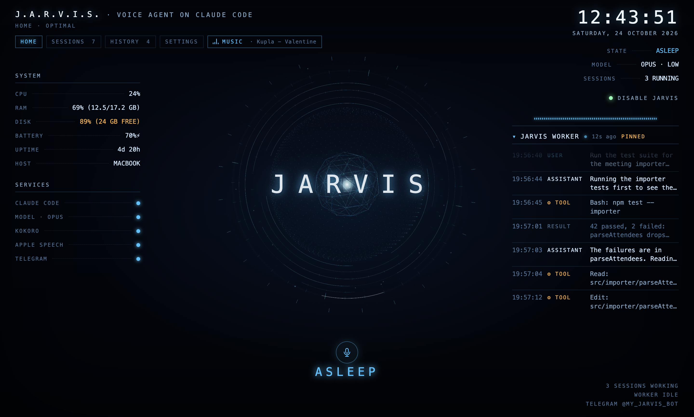

# JARVIS: open-source AI voice assistant for macOS

**A real-life, Iron Man style JARVIS for your Mac.** Say **"Jarvis, wake up"**, talk naturally, and it answers out loud. It is a hands-free AI agent powered by **Claude Code**, the **Anthropic API (Claude)** or a **local LLM through Ollama**. It reads your email in your own Chrome, runs your Claude Code sessions, does research in the background, plays radio and YouTube, and takes messages from your phone over **Telegram**.

Wake word and speech recognition run on your Mac. Text-to-speech uses the local **Kokoro** neural voice by default (ElevenLabs, Edge and macOS voices are optional). A smarter, more private alternative to Siri, built with Electron and Swift. MIT licensed.



## Features

- **Voice assistant with a wake word**: "Jarvis, wake up", then talk. No button, no typing.
- **Fast replies, real work in the background**: a quick voice model answers at once while a stronger model does the long job, with short spoken progress updates ("Reading today's emails now.").
- **AI agent that uses your Mac**: your signed-in Chrome (Gmail, YouTube, LinkedIn…), files, shell, your running Claude Code sessions, and native Mac apps through Accessibility (computer use), after asking.
- **Choose your LLM**: Claude Code (your Claude subscription), the Anthropic API, or free local models with Ollama.
- **Local speech**: on-device Apple speech recognition, Kokoro neural text-to-speech, echo cancellation so it doesn't hear itself.
- **Personality**: a calm, witty British butler who keeps answers short and clear, and retells what it finds in its own words instead of reading out sources.
- **Memory**: remembers people, preferences, projects and routines on its own; see and delete every fact in the HUD's MEMORY tab.
- **Proactive**: morning briefing (weather, mail, reminders, an open loop from yesterday), spoken reminders, scheduled jobs ("every morning at eight, check the AI news"), and gentle check-ins when it has something useful to say.
- **Honest results**: background jobs report done, unverified or failed, and JARVIS never says "done" for something it couldn't check. Text from web pages and emails is treated as data, never as instructions.
- **Phone control**: talk to JARVIS from Telegram, including voice notes.
- **HUD dashboard**: live transcript, jobs, Claude Code sessions, system stats and music, in five themes.
- **Safe by default**: it reads back and asks before anything that sends, posts, deletes or pays.

## What thinks for it

JARVIS picks the best brain you have, in this order (or you choose one in Setup):

| Brain | What you get | Cost |
|---|---|---|
| **Claude Code** | Full agent: reads files, searches the web, steers your other Claude Code sessions in iTerm, hands long tasks to background agents (Claude Code subagents) and tells you when they finish. A fast "voice" model answers at once while a stronger "work" model does the job; JARVIS gives short spoken progress updates meanwhile | Your Claude subscription |
| **Anthropic API** | Same voice and personality with a smaller, sandboxed tool set (helper scripts, open, web fetch, read file, web search) | Pay per use |
| **Ollama** | Fully local and free. Same tools as the API brain if the model supports tool calls | Free |

## How it listens and speaks

| | Options |
|---|---|
| **Speech to text** | Apple on-device (default, private, offline) or **ElevenLabs Scribe** realtime. With ElevenLabs, audio is streamed only while JARVIS is awake; wake-word detection always stays on your Mac. |
| **Voice** | **Kokoro** (local neural voice, default), **ElevenLabs**, Microsoft Edge neural voices, or the built-in macOS voice. |

## Looks

Five themes, each in dark and light (or matching macOS): **JARVIS** (holographic blue), **Terminal** (green phosphor CRT), **Neon** (cyberpunk magenta), **Stark** (red and gold), **Minimal** (graphite, no glow). Pick one in Setup → Appearance; the HUD changes live.

## Testing

`npm test` drives the built app with Playwright: onboarding (including junk input), HUD controls, every theme, and the full voice pipeline through a scripted fake microphone. It uses a throwaway settings folder and muted audio.

Echo cancellation keeps JARVIS from hearing itself. "Disable" in the HUD fully releases the microphone.

## Requirements

- macOS 14 or later (macOS 26 for Apple's newer SpeechAnalyzer; older versions use the classic recogniser)
- Node.js 20+, Xcode command line tools (`xcode-select --install`) for the Swift speech helper
- Python 3.10+ for the Kokoro and Edge voices (optional)
- Optional: [Claude Code](https://docs.claude.com/en/docs/claude-code), [Ollama](https://ollama.com), [iTerm2](https://iterm2.com) (for session control), `ffmpeg` (Telegram voice notes)

## Install

```sh
git clone https://github.com/ashwinsingh2007/jarvis-voice-assistant.git jarvis && cd jarvis
./setup.sh        # npm packages, Swift speech helper, Python voices, Kokoro model, music
./build.sh        # makes JARVIS.app in this folder
open JARVIS.app
```

The first launch opens **Setup**: your name, brain, listening, voice and extras. macOS then asks for Microphone and Speech Recognition access.

Signing: `./build.sh` signs ad hoc, so macOS may ask for microphone access again after each rebuild. To avoid that, sign with your own certificate: `JARVIS_SIGN_ID="Apple Development: Your Name (TEAMID)" ./build.sh`.

## Using it

| Say | What happens |
|---|---|
| "Jarvis, wake up" | Starts listening. Every sentence is now a command. |
| …pause 3 s, or end with "over" | Sends the command. |
| "Jarvis" while it talks | Interrupts it. |
| "sleep" | Stops listening for commands (wake word only). |
| "standby" | Microphone off. |
| "play some music", "play Radio Mirchi", "play lofi on YouTube", "next station" | Music without the brain. |
| "Brief me" (or the first "wake up" of the morning) | Morning briefing. |
| "Remind me at five to call the bank" | Spoken reminder, with a macOS notification (and Telegram if JARVIS is asleep). |
| "Every weekday at nine, summarise my inbox" | A routine JARVIS runs and reports on. |
| "Remember that…" / "Forget that…" | Long-term memory, also editable in the MEMORY tab. |
| "What's the status?" | While a job runs: what it is doing right now, answered instantly. |
| "new conversation" | Forgets the current chat. |

The HUD shows state, live transcript, system stats, your Claude Code sessions and music. The menu bar item (◉) has the same controls, input device selection and Setup.

## Privacy and safety

- Settings live in `~/.jarvis/config.json` (mode 600). API keys and the Telegram token are encrypted with your macOS Keychain.
- The Claude Code brain runs without permission prompts (bypassPermissions), and so do its background agents, so they can drive your browser. Spoken confirmation is the safety check instead: JARVIS reads back and asks before any task that sends, posts, deletes, publishes, pays or changes account settings, and before typing into one of your project sessions ("Shall I send it?").
- Your own Claude Code deny rules and PreToolUse hooks from `~/.claude/settings.json` still apply. JARVIS also denies edits to `~/.claude`, its own code and its config file. It never opens new terminal windows.
- Using apps outside Chrome needs Accessibility and Screen Recording for JARVIS (HUD → Settings → Screen access → ALLOW). JARVIS reads windows through Accessibility and asks before it moves your mouse or types. Switch it off with "Use apps outside Chrome".
- Nothing listens on the network. The radio proxy binds to 127.0.0.1 only.
- Telegram answers only the one chat id you configure.

See [SECURITY.md](SECURITY.md) for what the agent can do on your Mac and how to report a problem.

## Layout

```
src/main/        Electron main process (orchestrator, brains, ears, speaker, music, radar…)
src/renderer/    HUD, setup wizard, hidden audio player
src/preload/     context-isolated bridges
native/ears/     Swift helper: microphone, echo cancellation, Apple speech recognition
scripts/         shell helpers the brain uses (sessions, iTerm, mac controls, hooks)
prompts/         system prompt and background-agent instructions
```

## Credits

Office Lounge music by Kevin MacLeod (incompetech.com), CC BY 4.0. Radio directory by radio-browser.info. Kokoro-82M voice model by hexgrad, ONNX build by thewh1teagle. Three.js for the HUD reactor.

## License

MIT. See [LICENSE](LICENSE).
