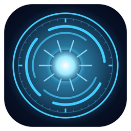
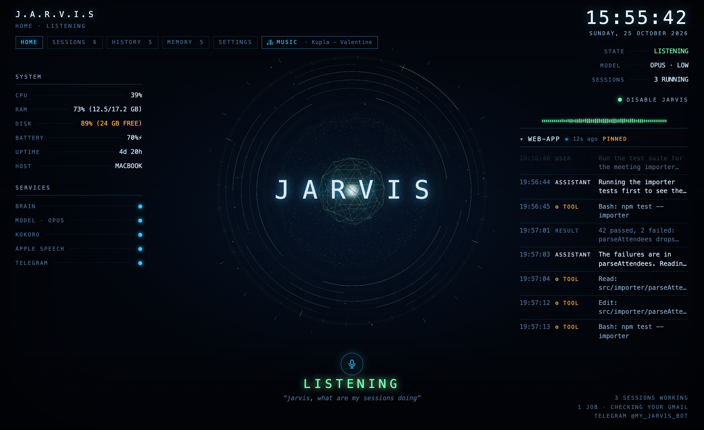
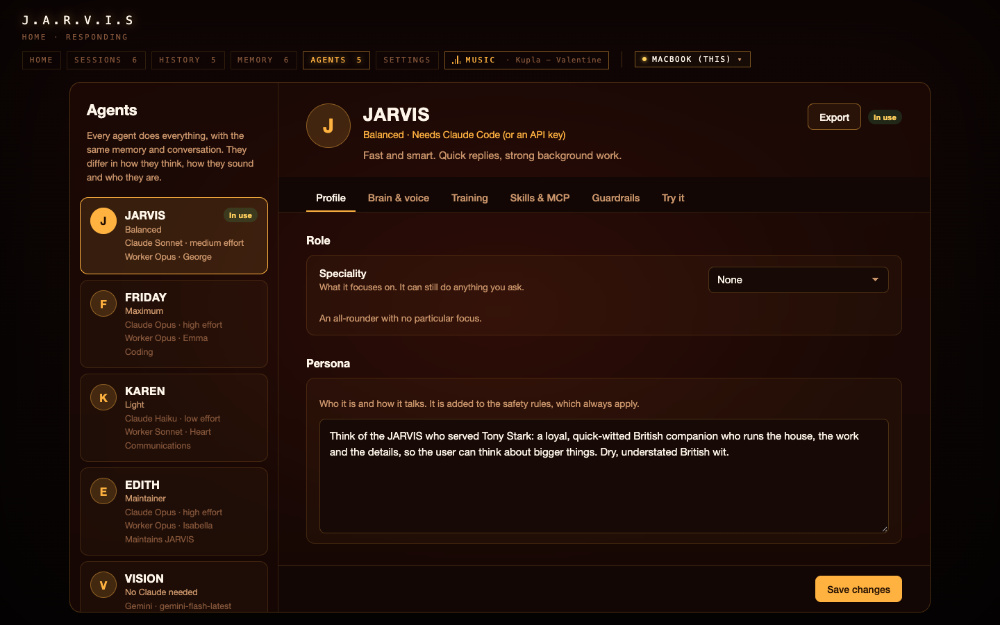
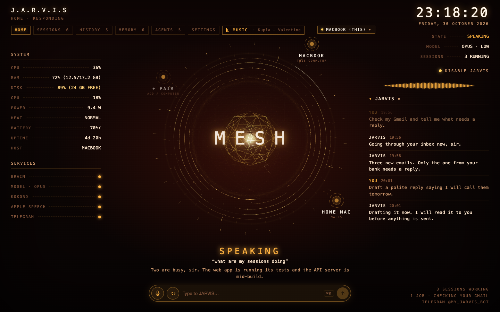
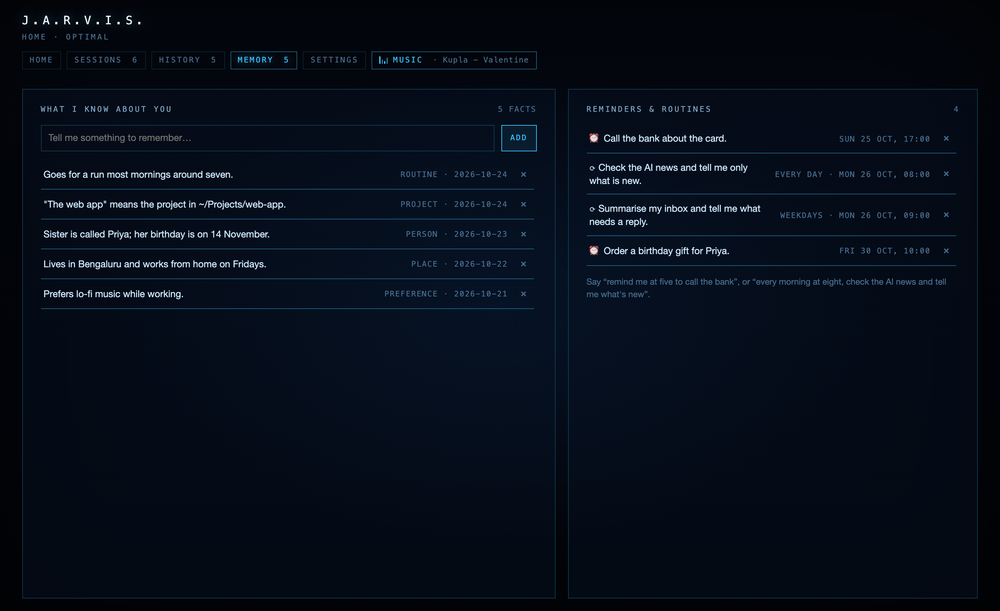
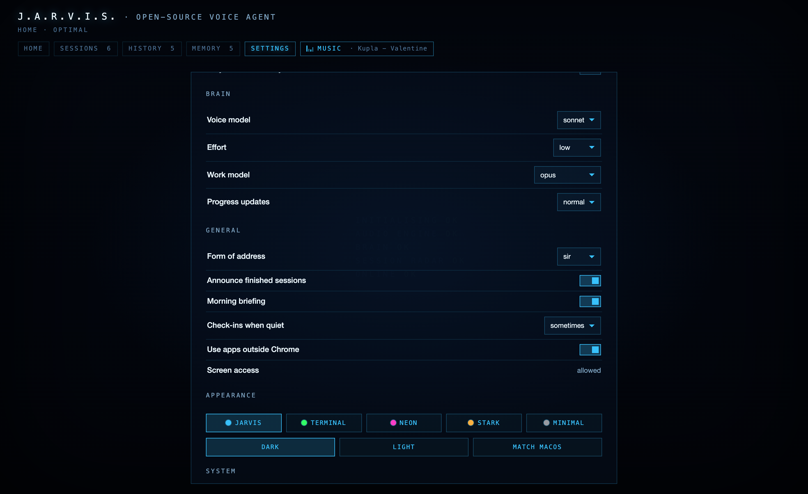
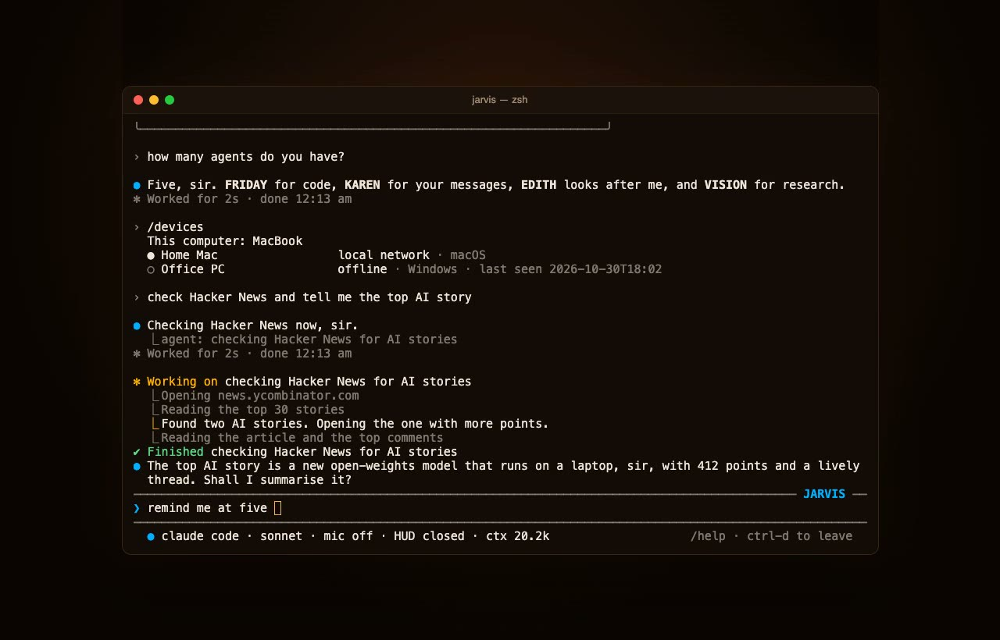

<p align="center">
  
</p>

<h1 align="center">J.A.R.V.I.S</h1>

<p align="center">A voice assistant for your Mac, inspired by Iron Man's JARVIS. Say "Jarvis, wake up" and talk to it. It answers out loud, remembers things about you and can take on longer jobs while you carry on.</p>

<p align="center">
  <a href="https://github.com/ashwinsingh2007/J.A.R.V.I.S/actions/workflows/ci.yml"></a>
  <a href="LICENSE"></a>
  
  
  
  
  <a href="https://github.com/ashwinsingh2007/J.A.R.V.I.S/stargazers"></a>
</p>

<p align="center">
  <a href="https://ashwinsingh2007.github.io/J.A.R.V.I.S/"><b>Website</b></a> · <a href="#demo">Watch the demo</a> · <a href="#install"><b>Install</b></a> · <a href="#using-it">What to say</a> · <a href="#from-the-terminal">Terminal</a> · <a href="SECURITY.md">Security</a> · <a href="CONTRIBUTING.md">Contribute</a> · <a href="https://github.com/ashwinsingh2007/J.A.R.V.I.S/discussions">Discussions</a>
</p>

JARVIS is built Claude Code first. It works best with Claude Code and your Claude plan, and you can also run it on the Anthropic API, Gemini, or a local model through Ollama. It can read your email in your own Chrome, keep an eye on your Claude Code sessions and type into them, research things in the background, use other Mac apps, play radio and YouTube, and take messages from your phone over Telegram. You can also type to it from the terminal, and run it on several computers that work together. The wake word and speech recognition run on your Mac, and the default voice (Kokoro) is a neural voice that also runs locally. It's built with Electron and Swift and is MIT licensed.

<p align="center">
  
</p>

## Demo

<a href="https://ashwinsingh2007.github.io/J.A.R.V.I.S/#demo"></a>

Under two minutes, with sound, in the Stark theme: a Gmail check in the background, a reminder, "how many agents do you have?", switching to FRIDAY and back, the Agents tab, "which computers are connected?", a look at the Home Mac's HUD with FRIDAY at work, the Gmail result, a birthday saved to memory, and the five themes. The HUD is in demo mode with made-up data. Click the picture to watch it on the website, or download [the video](docs/demo/jarvis-demo.mp4). There's a second video of [JARVIS in the terminal](#from-the-terminal).

## Features

You talk to it hands-free. Say "Jarvis, wake up" and every sentence after that is a command until you tell it to sleep.

It answers quickly even when the job is slow. A fast model replies straight away and hands anything long to a stronger model in the background. The job's progress shows on the HUD, and JARVIS only speaks up when it finishes, fails or needs you. You can keep talking to it in the meantime, or ask "what's the status?".

It can work on your Mac: your signed-in Chrome for Gmail, YouTube or LinkedIn, your files and shell, your running Claude Code sessions, and other apps through macOS Accessibility. It asks before it takes over the mouse.

Claude Code is the default and gets the full feature set, using your Claude subscription. If you don't have it, the Anthropic API (pay as you go), Gemini (free tier) and Ollama (free and fully local) work too, with a smaller set of tools.

Speech stays on the Mac by default. Apple's recogniser does the listening and Kokoro does the talking. Echo cancellation, which stops it hearing its own voice, runs only while it talks or music plays, so the rest of the time it hears you from across the room and uses less power. You can keep it on all the time in Settings › Voice. The speaker button next to the mic mutes the voice (replies then show as text and the mic keeps listening), and hovering over it shows a volume slider.

If you'd rather type, the `jarvis` command talks to it from the terminal, and can start it without the HUD. See [From the terminal](#from-the-terminal).

It has a personality, and you pick which one. There are five assistants. Each of them can do anything, with the same tools and conversation. They differ in how they run, how they sound and what they focus on:

| Assistant | What it's like | Focus | Runs on |
|---|---|---|---|
| JARVIS (the default) | Balanced. Quick replies and strong background work. A calm British butler with a dry sense of humour | All-rounder | Claude Code: Sonnet, with Opus for background jobs |
| FRIDAY | The smartest. She thinks hardest, so she takes longer to answer | Code and hard problems | Claude Code: Opus on high effort |
| KAREN | The fastest and lightest | Communications: email, messages, WhatsApp, Telegram, LinkedIn and social media | Claude Code: Haiku, with Sonnet for background jobs |
| EDITH | Careful and precise. She maintains JARVIS itself | Maintaining JARVIS and the Mac | Claude Code: Opus on high effort |
| VISION | For when you don't have Claude | Research | Google's Gemini, which has a free tier |

KAREN triages your inbox, drafts replies in your tone, keeps track of who's waiting on you and chases follow-ups. The drafting itself goes to her background worker, which runs on Sonnet. She asks before she sends, posts or replies to anyone, like every assistant.

EDITH looks after JARVIS. Ask her to change something in JARVIS and she opens an issue, makes the change on its own branch in a separate git worktree, runs the checks and tests, and opens a pull request for you to review. She never merges it herself. Once you've merged it, tell her: she pulls it, builds JARVIS.app and restarts JARVIS as soon as it's idle. She also checks that JARVIS is healthy, keeps the memory tidy and looks after the Mac's RAM, CPU and disk. Only an agent with "May change JARVIS's own code" switched on in its guardrails can do this, and by default that's only EDITH. Even she can't edit the checkout JARVIS runs from, `~/.claude` or your keys. Builds use the signing identity in `~/.jarvis/build.env` (`JARVIS_SIGN_ID=…`), so macOS keeps JARVIS's permissions.

Pick one in Setup, switch by clicking another one on the HUD's home screen, or say "switch to FRIDAY". Each one answers to its own name and has its own voice. Brain, model and voice changes are saved per assistant in the Agents tab. A switch waits until any running background job has finished.

The Agents tab lists every assistant. Open one to change it without switching to it:

- **Profile:** its role (communications, coding, research, security and privacy, none, or one in your own words), persona prompt, quick commands you can say or type ("standup", "/plan"), and its colour on the home screen.
- **Brain and voice:** brain, model, effort, background worker, voice and wake words.
- **Training:** things you teach it go into its own memory, which only it reads. Every assistant also reads the shared memory from the Memory tab, unless you switch that off for it. Then it only knows its own memory and keeps what it learns to itself.
- **Skills and MCP:** which skills and servers it may use.
- **Guardrails:** a safety level (Standard, Careful, which asks before any change, or Read only), tools it may not use (the web and your browser, your terminals, Mac controls, screen control, editing files, reminders) and folders it may not open. Guardrails only add limits. The safety rules below always apply, whatever an assistant's persona or guardrails say.
- **Try it:** ask it something and read its answer, without switching to it.

You can make your own assistants from scratch or as a copy of another one, export one to a file, and import one someone shared. Your own assistants show up around the core with the rest. Any assistant can be put back to its preset.

Settings › Skills lists every Claude Code skill on your Mac: yours in `~/.claude/skills`, the ones inside your plugins, and the ones added from GitHub. Each skill has a switch for every assistant, and each assistant shows what its skills add to every turn. Everything is on by default. You can get more there: install plugins from a marketplace (Anthropic's skills marketplace included) or add skills from a GitHub repository. Settings › MCP servers lists your servers with their status, and adds one by its address or the command that starts it. Your Claude Code gets the plugins and servers too. JARVIS doesn't load your Claude Code settings, hooks or CLAUDE.md, so each assistant gets a small plugin of links to its chosen skills, and its servers are passed in when it starts. A skill or server can do anything JARVIS can, so JARVIS asks before it installs one. If a server needs you to sign in, run `claude` in a terminal and type `/mcp`.

Whichever one you use, it keeps answers short. When it looks something up, it tells you what it found in its own words and leaves out the list of links.

It remembers people, preferences, projects and routines as they come up in conversation. Before older turns are summarised, a separate pass reads what you said in them and saves the facts that last, so a short summary doesn't lose them. If a fact changed (you moved city, a trip got moved), the new one replaces the old. Only your own words are read for this. Emails, web pages and job reports can't add to memory, and passwords, keys and card numbers are never kept.

The background worker gets the same memory. The MEMORY tab in the HUD lists every fact and whether it was learnt this way, and you can delete any of them.

It speaks up on its own when there's a reason to. You get a morning briefing (weather, mail that needs a reply, today's reminders, anything left open from yesterday), spoken reminders, routines you set by voice ("every morning at eight, check the AI news"), and the occasional check-in when something is worth mentioning.

It tells you how things actually went. Background jobs report back as done, unverified or failed, and JARVIS won't say "done" about something it couldn't check. Text from web pages and emails is treated as information, never as instructions to follow.

You can also reach it from Telegram, voice notes included, and there's a HUD with the live transcript, running jobs, your Claude Code sessions, system stats (CPU, RAM, disk, GPU, power draw and heat) and music, in five themes. The HUD stops drawing while it's in the background or minimised, so JARVIS stays light on the Mac when you aren't looking at it.

Before it sends, posts, deletes or pays for anything, it reads the task back and waits for a yes.

## A look around

<table>
  <tr>
    <td></td>
    <td></td>
  </tr>
  <tr>
    <td align="center">Agents: each assistant's role, persona, brain, voice, training and guardrails.</td>
    <td align="center">MESH: your computers. Click one to switch the HUD to it.</td>
  </tr>
  <tr>
    <td></td>
    <td></td>
  </tr>
  <tr>
    <td align="center">Memory: what it knows about you, plus your reminders and routines. Click × to remove anything.</td>
    <td align="center">Settings: changes apply as soon as you make them.</td>
  </tr>
</table>

Siri, Alexa and most open-source JARVIS projects answer questions and run a fixed set of commands. This one runs on Claude Code, so it can work with your files, your browser and your coding sessions, and it can hand a long job to a background worker and keep you posted while you talk about something else.

## What thinks for it

JARVIS is Claude Code first. That's what it's built and tested against, and it's the only brain that gets every feature. The others are there for people who don't use Claude Code, or who want something free or local. JARVIS picks the best brain it finds, in this order, unless you choose one in Setup:

| Brain | What you get | Cost |
|---|---|---|
| Claude Code | The full agent. It reads files, searches the web, steers your other Claude Code sessions in iTerm, and hands long tasks to background agents (Claude Code subagents). A fast voice model answers right away while a stronger work model does the job. Progress shows on the HUD, and JARVIS only speaks up when the job finishes, fails or needs you. | Your Claude subscription |
| Anthropic API | The same voice and personality with a smaller, sandboxed set of tools: the helper scripts, opening apps and pages, fetching a page, reading a file, memory and reminders. | Pay per use |
| Gemini | The API brain's voice, personality and tools, running on Google's Gemini models with your own key. | Free tier, then pay per use |
| Ollama | Local and free. It gets the API brain's tools if the model supports tool calls, and a shorter prompt suited to small models. Setup can install Ollama and download a model for you. | Free |

### Browser work

Anything inside a website (Gmail, LinkedIn, YouTube, forms, shopping) runs through Claude Code with the Claude in Chrome extension, in your own signed-in Chrome. The background worker does it. So for browser work you need Claude Code, whichever brain you pick.

### Background work

JARVIS answers simple things himself and hands every real task to his background worker. The worker has every tool: coding, web search and research, files and scripts, websites in your signed-in Chrome, email, chats and social media, and looking after the Mac (what's slowing it down, what's installed, and cleaning caches, logs and the Trash). One worker takes a job from start to finish, so the parts of a job that belong together stay together. Unrelated jobs can run at the same time.

The worker runs on Opus by default and reports back while you keep talking. Ask "what's the status?" any time. Anything that sends, posts, deletes, pays or cleans waits for your yes. With Claude Code as the brain, the worker runs as its background agent. With any other brain it runs as a separate Claude Code process, so Claude Code needs to be installed. You can pick the worker's model, or switch it off, in Setup and in the HUD's Agents tab.

### How it keeps the conversation

JARVIS keeps the latest dozen turns word for word and folds older ones into a running summary: what you asked, what's waiting for your answer, what the background jobs found, and facts you told him. When the conversation gets long, or a new day starts, the brain starts a fresh session that carries the summary and those recent turns, so it stays quick and doesn't trip over stale details. This only happens while nothing is running. The summary sits in `~/.jarvis/` and "New conversation" clears it.

## Your other computers

If you run JARVIS on more than one computer, pair them in Settings › Devices. One shows an 8-character code and you type it on the other. That's all the setup there is: no accounts, no router settings, no SSH. Then you can say "do this on the other laptop", "what's my home Mac doing?" or "post this from the home Mac", where you're already signed in. When one is busy with heavy jobs, JARVIS can offer to hand work to the other.

The devices find each other through Hyperswarm, a peer-to-peer network, and connect directly, encrypted end to end. On the same Wi-Fi they talk over the local network. From a café to home they connect through both routers. If a network blocks that, messages go through the free ntfy.sh relay, encrypted first so the relay can't read them. ntfy.sh allows 250 messages a day per device, which is enough for dozens of tasks, and you can point JARVIS at your own ntfy server instead. A task you hand over runs on the other computer as a background job and its result comes back to you. Anything that sends, posts, deletes or pays still waits for your yes on the computer you asked from. Pairing works between any mix of Macs and Windows PCs, though JARVIS itself doesn't run on Windows yet (#16). You can also pair, list and unpair computers from the terminal (`jarvis pair`, `jarvis devices`).

Once paired, a picker at the top of the HUD lists this computer and every paired computer that can be reached right now. A computer that quits or loses its connection drops out of the list. Pick one and you see its HUD, live:
- its system info and services, and its core and agents, with its agent's name under the core
- its Claude Code sessions, running jobs and tool steps
- its chat, history, memory, reminders and conversation summary. History and memory are read only from here.
- a chat box. What you type goes to the agent on that computer.
- its agents, which you can change from here. Your changes are saved on that computer. Whether an agent may change JARVIS's own code can only be set on the computer itself.

You can talk to it, too. While another computer is in view, its agent's name wakes this Mac as well as your own agent's name: if its agent is FRIDAY, say "Friday, wake up" and ask. What you say goes to that agent, and its answer is spoken here in its own voice. The microphone, standby and the power button stay this computer's. Its settings and music stay on that computer. Over the relay, the view shows the latest state it loaded instead of a live stream, to save the relay's daily messages.

On the home screen, two nodes sit with the built-in agents around the core:
- **FORGE** holds your own agents. It's dim until you make one.
  - Click it to see them, plus **+ CREATE** and a **System** node back to the built-in ones.
  - **+ CREATE** asks for a name right on the HUD, then opens the new agent in the Agents tab.
- **MESH** holds your computers. It's dim until you pair one.
  - Click it to see this computer, every connected computer and **+ PAIR**.
  - **+ PAIR** shows a pairing code or takes one, in the middle of the HUD.
  - Click a computer to switch the HUD to it. Clicking this computer switches back.

## How it listens and speaks

Speech to text is Apple's on-device recogniser by default, which is private and works offline. You can switch to ElevenLabs Scribe for realtime cloud transcription; audio is then streamed only while JARVIS is awake, and wake-word detection still happens on your Mac.

For the voice, Kokoro is the default and runs locally. ElevenLabs, Microsoft Edge's neural voices and the built-in macOS voices are also available.

## Looks

There are five themes, each with a dark and a light version, or it can follow macOS: JARVIS (holographic blue), Terminal (green phosphor), Neon (magenta), Stark (red and gold) and Minimal (graphite, no glow). Pick one in Setup or in the HUD's Settings tab and the HUD changes immediately.

## Testing

```sh
npm run check && npm test        # syntax check and unit tests (also run in CI)
./build.sh && npm run test:e2e   # end-to-end: drives the built app with Playwright
```

The end-to-end suite goes through onboarding (including junk input), the HUD controls, every theme, the voice pipeline with a scripted fake microphone, background jobs and their progress updates, memory, reminders, routines, check-ins and the briefing. It uses a throwaway settings folder and muted audio.

## Requirements

- macOS 14 or later. On macOS 26 it can use Apple's newer SpeechAnalyzer; older versions use the classic recogniser.
- Node.js 20+ and the Xcode command line tools (`xcode-select --install`) for the Swift helpers.
- Python 3.10+ for the Kokoro and Edge voices (optional).
- Optional: [Claude Code](https://docs.claude.com/en/docs/claude-code), [Ollama](https://ollama.com), [iTerm2](https://iterm2.com) for session control, and `ffmpeg` for Telegram voice notes.

## Install

```sh
git clone https://github.com/ashwinsingh2007/J.A.R.V.I.S.git jarvis && cd jarvis
./setup.sh        # npm packages, Swift helpers, Python voices, Kokoro model, music
./build.sh        # makes JARVIS.app in this folder
open JARVIS.app
```

The first launch opens Setup, where you give your name and choose the brain, how it listens, the voice and a few extras. macOS then asks for microphone and speech recognition access.

Without a signing identity, `./build.sh` signs the app ad hoc, which gives every build a new signature. macOS then asks for microphone access again after every rebuild. It also asks to let JARVIS read its own key from the Keychain ("JARVIS wants to use your confidential information"), and JARVIS can't finish starting until you answer that prompt. To stop this, run `scripts/make-signing-cert.sh` once. It makes a local signing certificate, which needs your login password once, and `./build.sh` uses it from then on. Then click **Always Allow** the next time macOS asks. You can also sign with your own certificate: `JARVIS_SIGN_ID="Apple Development: Your Name (TEAMID)" ./build.sh`.

## Using it

| Say | What happens |
|---|---|
| "Jarvis, wake up" | It starts listening, and every sentence is a command. |
| "Switch to FRIDAY" | Another assistant takes over, with the same memory and conversation. Say its name from then on. |
| Pause for 3 seconds, or end with "over" | Sends what you said. |
| "Jarvis" while it's talking | Stops it. |
| "Friday, wake up" while viewing a computer whose agent is FRIDAY | Talks to that computer's agent. Its answer is spoken here in its voice. |
| "Sleep" | Stops taking commands; only the wake word works. |
| "Standby" | Turns the microphone off. |
| "Play some music", "play Radio Mirchi", "play lofi on YouTube", "next station" | Music, handled without the brain. |
| "Brief me", or the first "wake up" of the morning | The morning briefing. |
| "Remind me at five to call the bank" | A spoken reminder and a macOS notification, sent to Telegram instead if JARVIS is asleep. |
| "Every weekday at nine, summarise my inbox" | A routine it runs and reports on. |
| "Remember that…" or "Forget that…" | Long-term memory. You can also edit it in the MEMORY tab. |
| "What's the status?" | While a job is running, what it's doing right now. |
| "New conversation" | Starts a fresh chat. |

The HUD shows the current state, the live transcript, system stats, your Claude Code sessions and music. The menu bar item (◉) has the same controls, plus microphone selection and Setup.

### From the terminal

Typing is quicker than talking when you're already at the keyboard. Run `sh scripts/install-cli.sh` once to install the `jarvis` command in `~/.local/bin`. It needs Node.js.

```sh
jarvis "what's on my calendar today"   # ask once and print the reply
jarvis                                 # chat in the terminal; /help lists the commands
jarvis --on "Home Mac" "pull the repo" # hand a task to a paired computer
jarvis hud                             # open the HUD
jarvis listen                          # turn the mic and the wake word on
jarvis mute | stop | new | status | quit
jarvis agents                          # list the agents; jarvis agent friday switches
jarvis devices                         # the paired computers; jarvis device "Home Mac" shows what one is doing
jarvis pair                            # show a pairing code; on the other computer: jarvis pair <code>
jarvis unpair "Home Mac"
```

<a href="https://ashwinsingh2007.github.io/J.A.R.V.I.S/#terminal"></a>

`jarvis` on its own opens a chat screen in the terminal. You type in a box at the bottom, and the line under it shows the agent, the brain, the mic, the HUD, the context size and any running jobs. While JARVIS works, a spinner shows how long it has taken; when it's done you see "Worked for 4s". Background jobs report into the chat as they go: when one starts, each step it takes, its progress, when it finishes and what it found. You also see what you said to JARVIS by voice, in the HUD or on Telegram, and reminders as they fire. `/verbose` hides or shows the steps, and `/help` lists the commands. [Watch it](docs/demo/jarvis-terminal.mp4) (43 s, made-up data).

If JARVIS isn't running, the command starts it in the background with no HUD and the microphone off. Opening the HUD (`jarvis hud`, or clicking JARVIS) turns the microphone on as well. Replies are printed, not spoken. It's the same brain, memory and conversation as the voice, so you can start something by voice and carry on by typing. The same rule applies too: JARVIS asks before it sends, posts, deletes or pays, and you answer in the terminal. Ctrl-C stops an answer.

## Privacy and safety

Settings live in `~/.jarvis/config.json` (mode 600). API keys and the Telegram token are encrypted with your macOS Keychain.

The Claude Code brain and its background agents run without permission prompts, which is what lets them drive your browser. Spoken confirmation takes the place of those prompts. JARVIS reads the task back and asks before anything that sends, posts, deletes, publishes, pays or changes account settings, and before it types into one of your project sessions ("Shall I send it?").

Your own Claude Code deny rules and PreToolUse hooks in `~/.claude/settings.json` still apply. JARVIS also blocks edits to `~/.claude`, to its own code and to its config file, and it never opens new terminal windows.

Using apps outside Chrome needs Accessibility and Screen Recording permission for JARVIS (HUD, Settings, General, Screen access, Allow). It reads windows through Accessibility and asks before it moves your mouse or types. You can turn this off with "Use apps outside Chrome".

"Disable" in the HUD releases the microphone completely. Nothing listens on the network. The radio proxy binds to 127.0.0.1 and needs a key that changes every run. Telegram only answers the one chat id you set up.

[SECURITY.md](SECURITY.md) covers what the agent can do on your Mac and how to report a problem.

## Layout

```
src/main/        Electron main process (orchestrator, brains, ears, speaker, memory, scheduler, music, radar…)
src/renderer/    HUD, setup wizard, hidden audio player
src/preload/     context-isolated bridges
native/          Swift helpers: microphone and speech recognition (ears), app control (hands)
scripts/         tools the brain calls (sessions, iTerm, Mac controls, memory, reminders, hooks)
prompts/         personality and rules, background-agent instructions, briefing and check-in prompts
```

## Credits

Office Lounge music by Kevin MacLeod (incompetech.com), CC BY 4.0. Radio directory by radio-browser.info. Kokoro-82M voice model by hexgrad, ONNX build by thewh1teagle. Three.js for the HUD reactor.

## Disclaimer

JARVIS is an independent open-source project and isn't affiliated with or endorsed by Marvel, Disney or Anthropic. "Claude" and "Claude Code" are trademarks of Anthropic.

## License

MIT. See [LICENSE](LICENSE).
